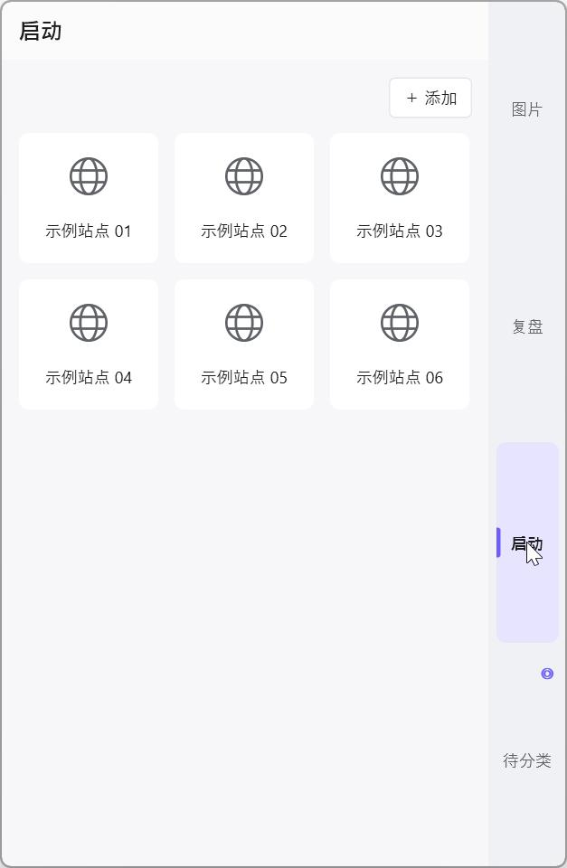
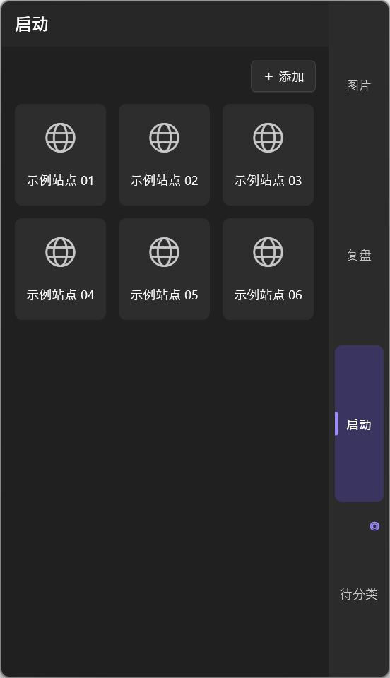
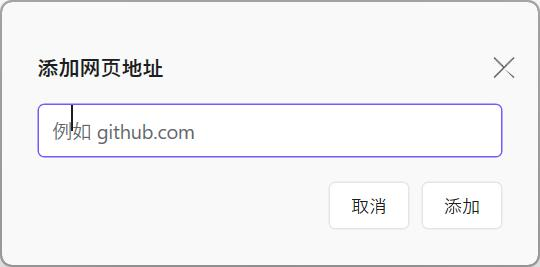

<h1 align="center">悬浮中转站</h1>

<p align="center">一个贴在屏幕边缘的文字与图片中转站——复制、拖进来、分个类，再把内容拖到真正需要它的软件里。</p>

<p align="center"></p>

<p align="center"><em>复制的内容自动入库，拖出去即可交付</em></p>

<p align="center">
  <a href="https://github.com/Oiawlm/floating-transfer-station/releases/latest"></a>
  <a href="https://github.com/Oiawlm/floating-transfer-station/stargazers"></a>
  <a href="https://github.com/Oiawlm/floating-transfer-station/issues"></a>
</p>
<p align="center">
  
  
  <a href="LICENSE"></a>
</p>

> [!IMPORTANT]
> 支持 Windows 11 64 位（1.7.0 起 Windows 以 Windows 11 为开发与验证目标）。Mac 端曾提供至 1.20.0 测试包，已于 2026-10-08 永久停止开发并从仓库移除；历史 Release（含 1.6.0 Intel Mac 包与 1.20.0 Apple Silicon 测试包）原样保留在 [1.6.0](https://github.com/Oiawlm/floating-transfer-station/releases/tag/v1.6.0) 与 [1.20.0](https://github.com/Oiawlm/floating-transfer-station/releases/tag/v1.20.0) 历史发行版中，不撤回、不更新。

## 目录

- [✨ 功能特性](#-功能特性)
- [📦 下载与安装](#-下载与安装)
- [🚀 常用操作速查](#-常用操作速查)
- [📖 功能详解](#-功能详解)
- [🖼️ 界面一览](#️-界面一览)
- [📁 数据与卸载](#-数据与卸载)
- [⚠️ 当前限制](#️-当前限制)
- [🗺️ 路线图](#️-路线图)
- [🛠️ 本地开发](#️-本地开发)
- [🤝 参与贡献](#-参与贡献)
- [📄 许可证](#-许可证)

## ✨ 功能特性

- **[随手收集](docs/usage.md#随手收集)**：复制图片或文字自动进入当前默认分类，5 秒内不重复收集相同内容。
- **[搜索过滤](docs/usage.md#搜索过滤)**：`Ctrl + F` 搜索当前分类，关键词与类型 chip 双重收窄，过滤不改任何数据。
- **[指定位置放入](docs/usage.md#指定位置放入)**：从资源管理器、浏览器、微信等软件把图片或文字直接拖到某个分类。
- **[批量复制](docs/usage.md#批量复制)**：一次复制多张图片按来源顺序入库，损坏文件不影响同批其他可用图片。
- **[图片容错](docs/usage.md#图片容错)**：多图片表示时自动保存像素最多的可用一份，照片保留正确的旋转方向。
- **[整理内容](docs/usage.md#面板与标签)**：置顶、多选、批量移动/删除、分类内排序；文字卡可就地编辑、添加备注（短卡备注入口可在设置「卡片备注」开启）。
- **[快捷启动](docs/usage.md#快捷启动)**：应用、已安装应用或网页地址一键成瓦片，单击即启动（上限 200 个）；应用瓦片显示真实提取图标，网页瓦片自动抓取目标站点的 favicon（仅直连目标网站，抓取失败显示地球字形）。
- **[每日复盘](docs/usage.md#复盘标签)**：按天保存本地 Markdown（`reviews/yyyy-MM-dd.md`），可与 Obsidian 等编辑器同步。
- **[AI 整理](docs/usage.md#ai-整理)**：填入 DeepSeek API Key 后，截断的长文字卡一键整理成干净文字，整理提示词可自定义，`Ctrl + Z` 恢复原文。
- **[自动清理](docs/usage.md#自动清理)**：非置顶卡片满保留时长自动删除（2～24 小时七档，默认 24），可整批撤销。
- **[复制与拖出](docs/usage.md#复制出去)**：右键或 `Ctrl + C` 复制到剪贴板；Windows 通用拖放格式可拖到其他软件。
- **[不挡工作区](docs/usage.md#不挡工作区)**：贴屏幕右侧保持最上层，空闲收成一条标签；支持保持展开与一次性贴边隐藏。
- **[检查更新](docs/usage.md#更新)**：发现新版本后按钮点亮，点击即自动「下载 → 校验 → 静默安装 → 重启」。
- **[设置](docs/usage.md#设置)**：主题、动效、标签顺序、快捷键、开机自启、数据目录、插件、DeepSeek Key 与整理提示词。
- **本地保存**：内容、顺序、置顶状态、分类名称和窗口位置全部保存在本机。

## 📦 下载与安装

在 [1.55.0 发行版](https://github.com/Oiawlm/floating-transfer-station/releases/tag/v1.55.0) 下载 Windows 安装程序：

| 平台 | 下载 | 状态 |
|---|---|---|
| Windows 11 x64 | [Windows 安装程序](https://github.com/Oiawlm/floating-transfer-station/releases/download/v1.55.0/FloatingTransferStation-Setup-1.55.0.exe) | 正式版 |

发行页同时提供 `SHA256SUMS.txt`。Windows 无需另装 .NET。

### Windows 安装

1. 运行安装程序。
2. 选择程序安装位置和内容存储父目录；不修改时使用当前用户的本地目录。
3. 安装完成后软件会启动，并在以后登录 Windows 时自动运行。

本地 Windows 构建产物使用中文名，GitHub Release 为了稳定下载链接使用上面的英文文件名。Release 页面中的 `Source code (zip)` / `Source code (tar.gz)` 是 GitHub 自动生成的源码包。

> [!NOTE]
> 安装包未经代码签名，首次运行时 Windows SmartScreen 可能提示「Windows 已保护你的电脑」——点击「更多信息」后选择「仍要运行」。运行安装程序更新版本后，开机自启会重新开启，可在设置中再次关闭。

## 🚀 常用操作速查

| 操作 | 效果 |
|---|---|
| 复制图片或文字 | 自动入库当前默认接收分类 |
| 拖内容到分类标签 | 放入指定分类 |
| 单击右侧分类标签 | 切换本次运行的默认接收分类 |
| 双击分类标签 | 原地改名（最多 6 个可见文字单元） |
| 双击卡片左半 | 文字卡就地编辑（图片卡不可编辑） |
| 单击卡片右半 | 选中；再点一次取消 |
| 右半 `Shift + 单击` | 连续区间选择（`Ctrl + Shift + 单击` 追加区间） |
| 悬停卡片右上角 | 置顶、多选、删除或添加备注（短卡备注可设置开启） |
| 右键卡片右半 | 复制这一张到剪贴板 |
| ⚠️ 顶部垃圾桶 | 有选择删选中；无选择左键清空非置顶、右键清空全部（可撤销） |

键盘底线（完整快捷键表见[操作手册](docs/usage.md#操作手册)）：

- `Ctrl + A` 全选当前分类内容，`Esc` 取消全部选择。
- `F2` 改名当前展开分类（`Enter` 保存、`Esc` 取消）。
- `Delete` 或 `Backspace` 只删除选中项（正在编辑文字时正常删字）。
- `Ctrl + P` 批量置顶或取消置顶（仅面板展开且不在编辑分类名称时生效）。
- `Ctrl + Z` 撤销最近一批删除或 AI 整理。
- `Ctrl + C` 复制选中项（面板持有键盘焦点且有选择时）。

## 📖 功能详解

每项功能的完整行为、边界、失败处理与全部快捷键，见[功能详解与操作手册](docs/usage.md)：

[面板与标签](docs/usage.md#面板与标签) ｜ [收集与入库](docs/usage.md#收集与入库) ｜ [查看与整理](docs/usage.md#查看与整理) ｜ [快捷启动](docs/usage.md#快捷启动) ｜ [不挡工作区](docs/usage.md#不挡工作区) ｜ [设置](docs/usage.md#设置) ｜ [更新](docs/usage.md#更新) ｜ [操作手册](docs/usage.md#操作手册) ｜ [历史版本兼容](docs/usage.md#历史版本兼容)

## 🖼️ 界面一览

<p align="center"></p>

*展开态面板的结构：分类标签、复盘标签、卡片与头部按钮组*

<p align="center"></p>

*浅色与深色主题同一面板*

<p align="center"></p>

*移开收成标签，移入展开，保持展开不再收起*

<details>
<summary><strong>界面图集（点击展开）</strong></summary>

**收集与拖放**


*一次复制三张图，按来源顺序入库*


*拖到指定分类标签，内容进入该分类*

**整理与置顶**


*多选、批量置顶、拖到另一分类*


*默认实线：置顶区与普通区之间的分隔标识；虚线见 [pinned-divider-dashed.png](docs/images/pinned-divider-dashed.png)，强调条见 [pinned-divider-accent-bar.png](docs/images/pinned-divider-accent-bar.png)，关闭（纯间距）见 [pinned-divider-none.png](docs/images/pinned-divider-none.png)*

**设置**


*设置窗口双栏布局：左侧导航 5 组，右侧内容页按卡片分组；深色主题见 [settings-window-dark.png](docs/images/settings-window-dark.png)，调整尺寸后经持久化恢复见 [settings-window-resized.png](docs/images/settings-window-resized.png)*


*「标签顺序」节深色主题：拖动行或用上移/下移按钮调整四个标签的显示顺序，行画刷随主题实时跟随*

**插件**

声明式插件，两类：**文本整理**（`text-cleaner`，文字入库前自动应用正则规则）与**文本动作**（`text-actions`，文字卡右键菜单「插件动作」对选中卡片批量应用规则——全有或全无、Ctrl+Z 可恢复）。设置区提供来源徽章、动作设置行内编辑、逐动作「试运行…」与「重新扫描」。放入带 `plugin.json` 的文件夹即可使用，内置「整理空白」与「中文排版整理」两个示例；作者指南见 [docs/plugins.md](docs/plugins.md)。


*声明式插件默认关闭，放入即出现在设置里；深色主题见 [settings-plugins-dark.png](docs/images/settings-plugins-dark.png)*

**AI 设置与 AI 整理**


*AI 设置节：Key 掩码保存（图中为假 Key），「测试连接」就地反馈结果；深色主题见 [settings-ai-dark.png](docs/images/settings-ai-dark.png)，失败提示见 [settings-ai-test-failure.png](docs/images/settings-ai-test-failure.png)*


*AI 整理入口：截断文字卡悬停时右上按钮组追加行的「AI 整理」按钮；深色主题见 [card-ai-organize-dark.png](docs/images/card-ai-organize-dark.png)，整理前后对比见 [card-ai-organize-before.png](docs/images/card-ai-organize-before.png) 与 [card-ai-organize-after.png](docs/images/card-ai-organize-after.png)*

**快捷启动**



*启动标签：瓦片网格随面板宽度拉伸铺满（无死区），单击瓦片即启动应用；深色主题见 [quicklaunch-surface-dark.png](docs/images/quicklaunch-surface-dark.png)*



*多选与批量删除：瓦片悬停/选中时右上角出现勾选钮（Ctrl/Shift/Ctrl+A 支持），选中后头部垃圾桶变为「删除已选 N 项」，删除可整批撤销；名称带双击就地改名，拖动排序全时可用*


*右键任意瓦片：打开／重命名／编辑目标…（创建后可改目标，Alt+Enter 同入口）／上移／下移（端点自动置灰）／删除（独立分组，可撤销）*



*「＋ 添加」→「网页地址…」对话框：与主面板一致的主题化不透明表面与系统圆角阴影；「已安装应用…」支持搜索过滤与多选一次添加（含商店等打包应用）；深色主题见 [quicklaunch-url-dialog-dark.png](docs/images/quicklaunch-url-dialog-dark.png)*

**复盘与更新**


*复盘按天保存，切换日期内容仍在*


*发现新版本：头部最左「更新」按钮点亮，点击即自动下载安装并重启*

</details>

## 📁 数据与卸载

> [!WARNING]
> 卸载会删除程序、自启项，以及应用登记并管理的 `悬浮中转站\Data`；不会删除你选择的父目录里的其他文件。重要内容仍建议另外备份。

- 默认程序目录是 `%LocalAppData%\Programs\悬浮中转站\`，默认数据目录是 `%LocalAppData%\悬浮中转站\Data\`。安装或更新时可以改选两者的位置。
- 从 1.4.3 或更早版本升级的步骤与卸载器边界说明，见[历史版本兼容](docs/usage.md#历史版本兼容)。

## ⚠️ 当前限制

以下限制适用于 Windows 正式版。

- 动态分类增删与常驻模式仍在路线图中；剪贴板采集开关等待收集更多使用场景。
- 每个编码图片表示或源文件最多 64 MiB、6,400 万像素，超限不会静默缩小原图；连续大量复制达到待处理容量上限时，会提示稍后重新复制。
- 外部拖放基于 Windows 通用格式；不同软件实际提供的格式不同，因此不是所有来源都能接收。
- 图片分类反馈稍晚、微信复制图片偶发生成两份，属于低优先级现场观察，自动测试环境未能稳定复现。

遇到问题可以提交 [Bug 报告](https://github.com/Oiawlm/floating-transfer-station/issues/new?template=bug_report.yml)，有新想法可以提交 [功能建议](https://github.com/Oiawlm/floating-transfer-station/issues/new?template=feature_request.yml)。

## 🗺️ 路线图

分类管理（动态增删）、外部拖入激活方式与常驻模式等仍需逐项设计，完整说明见[路线图](ROADMAP.md)。

## 🛠️ 本地开发

```powershell
& .\scripts\bootstrap-dotnet.ps1
& .\.tools\dotnet\dotnet.exe restore FloatingTransferStation.slnx

# 开发循环测试：按变更集选受影响区域（Core.Tests 恒跑基线；纯文档变更自动跳过）
& .\scripts\run-affected-tests.ps1

# 全量测试（发行打包与 CI 质量门使用；本地开发循环不要求）
& .\.tools\dotnet\dotnet.exe test FloatingTransferStation.slnx -c Release --no-restore
```

生成 Windows 安装包：

```powershell
& .\scripts\build-release.ps1
```

默认构建允许 `CHANGELOG.md` 中保留未发布记录；正式发布使用 `build-release.ps1 -ForRelease`，检查步骤见[发布指南](docs/releasing.md)。开发运行不会登记开机自启，自启项由安装器统一管理。版本变化见[更新记录](CHANGELOG.md)；更完整的改动规则见[贡献指南](CONTRIBUTING.md)，主要组件与数据流见[架构说明](docs/architecture.md)。

## 🤝 参与贡献

欢迎提交 Bug、使用反馈和 PR。新增主要交互、数据格式、安装/卸载范围或拖放契约前，请先开 Issue 对齐问题和边界，避免大家在不同假设上重复工作。

## 📄 许可证

本项目使用 [MIT License](LICENSE)。
