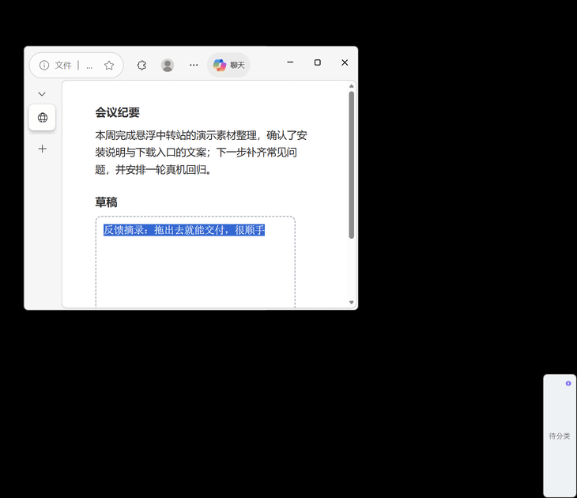
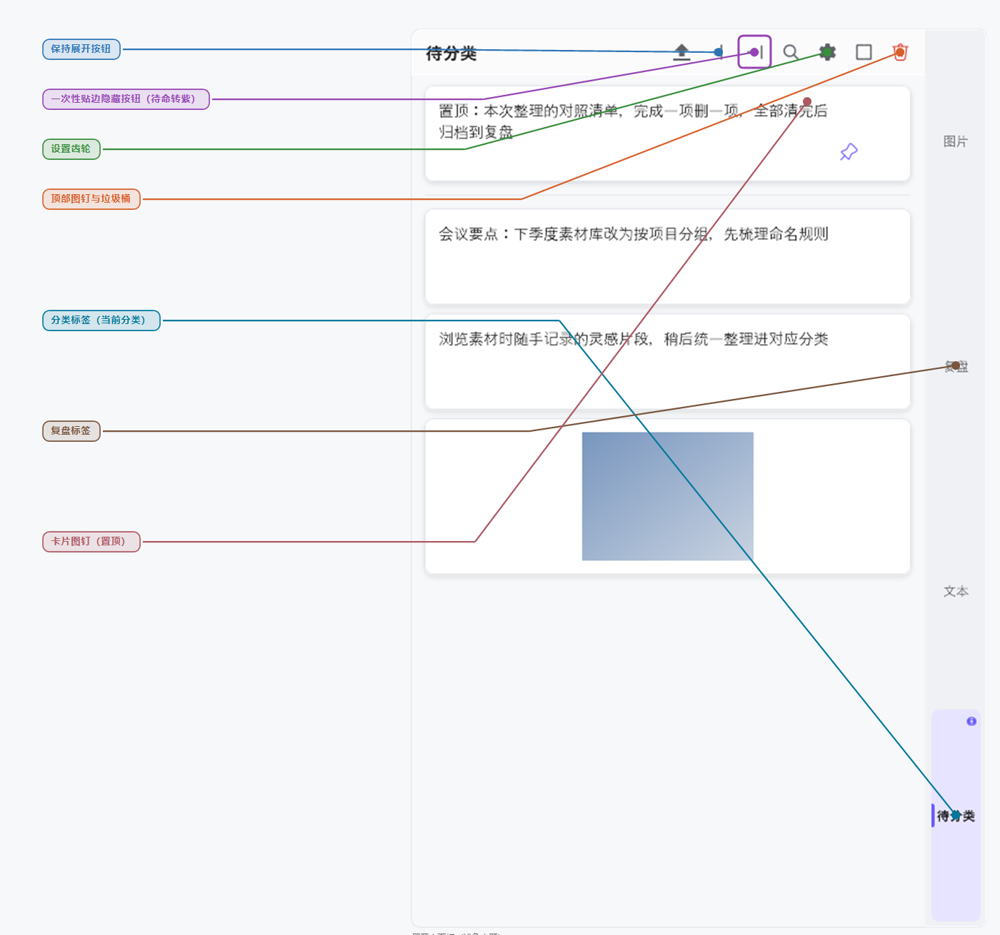
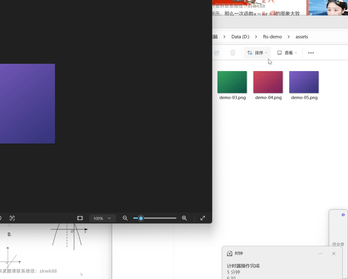
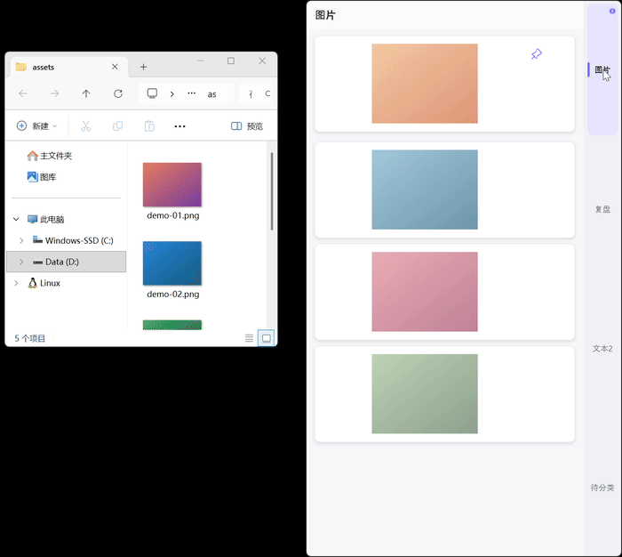
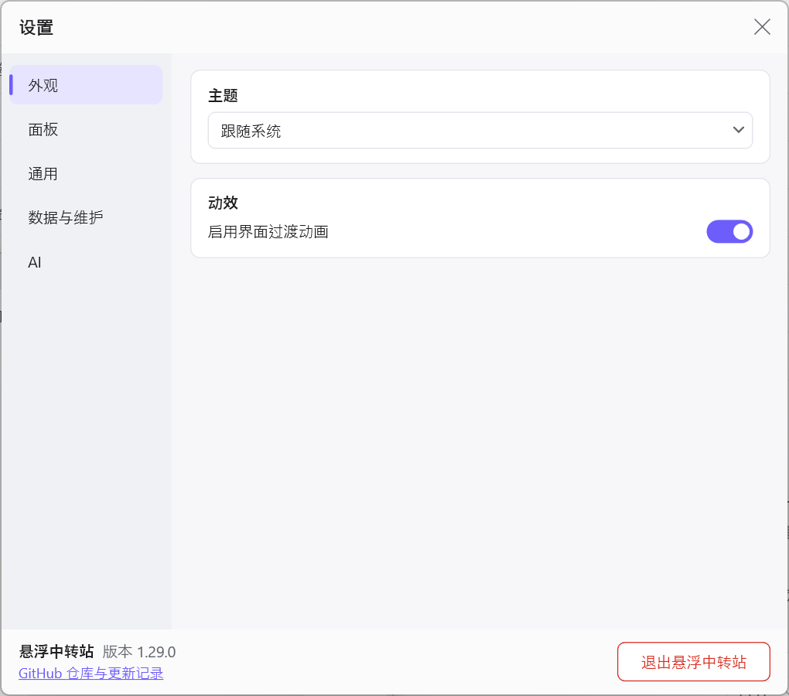
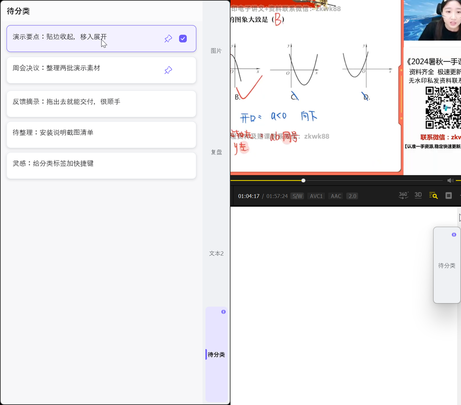
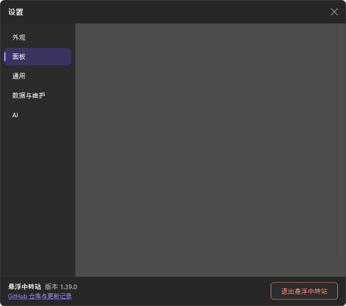
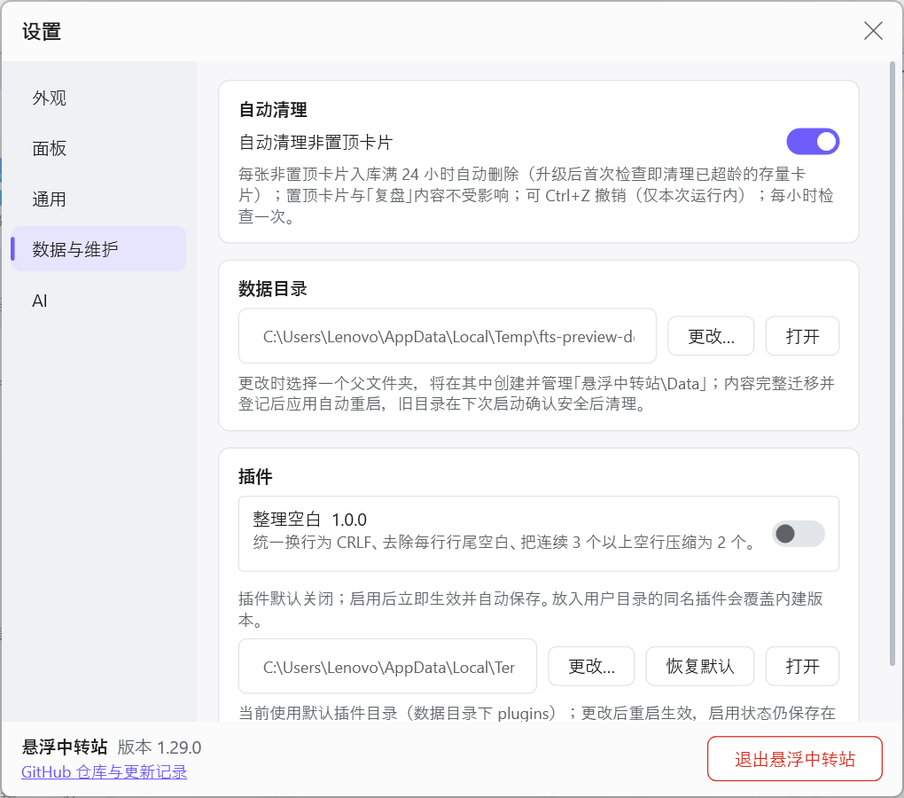
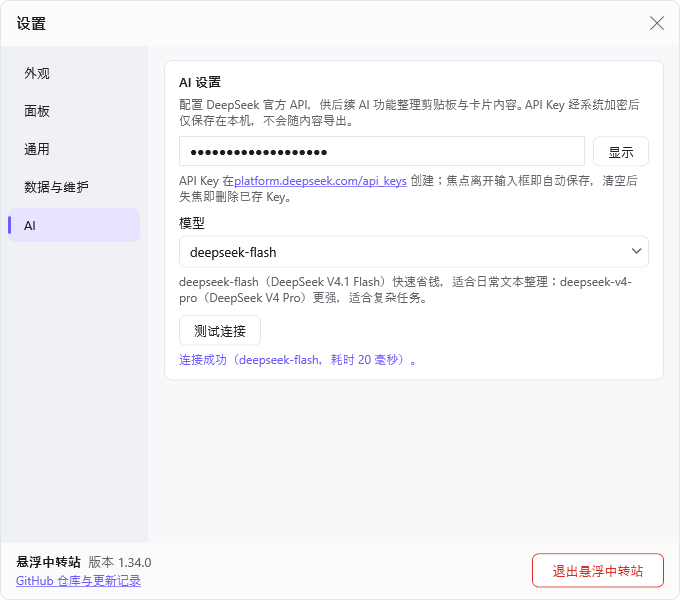
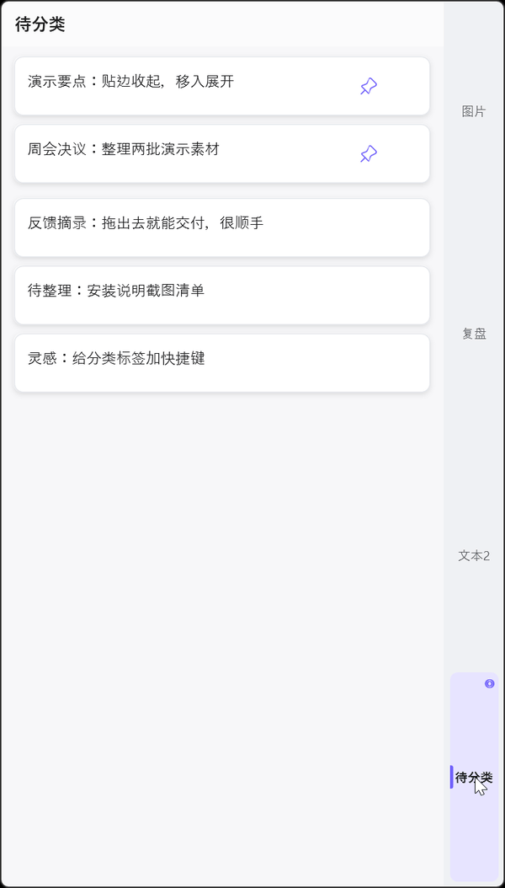

# 悬浮中转站

一个贴在屏幕边缘的文字与图片中转站。复制、拖进来、分个类，再把内容拖到真正需要它的软件里。

<p align="center"></p>

<p align="center"><em>复制的内容自动入库，拖出去即可交付</em></p>

> 支持 Windows 11 64 位。1.7.0 起 Windows 以 Windows 11 为开发与验证目标。2026-10-08 起 Mac 端永久停止开发并已从仓库移除；历史 Release（含 1.6.0 Intel Mac 包与最后的 Apple Silicon 测试包）原样保留在历史发行版中，不撤回、不更新。

## 下载与安装

在 [1.43.0 发行版](https://github.com/Oiawlm/floating-transfer-station/releases/tag/v1.43.0) 下载 Windows 安装程序：

| 平台 | 下载 | 状态 |
|---|---|---|
| Windows 11 x64 | [Windows 安装程序](https://github.com/Oiawlm/floating-transfer-station/releases/download/v1.43.0/FloatingTransferStation-Setup-1.43.0.exe) | 正式版 |

发行页同时提供 `SHA256SUMS.txt`。Windows 无需另装 .NET。

### Windows 安装

1. 运行安装程序。
2. 选择程序安装位置和内容存储父目录；不修改时使用当前用户的本地目录。
3. 安装完成后软件会启动，并在以后登录 Windows 时自动运行。

本地 Windows 构建产物使用中文名，GitHub Release 为了稳定下载链接使用上面的英文文件名。

Release 页面中的 `Source code (zip)` / `Source code (tar.gz)` 是 GitHub 自动生成的源码包。

## 它能做什么

以下为 Windows 正式版说明。



*展开态面板的结构：分类标签、复盘标签、卡片与头部按钮组；一次性贴边隐藏按钮呈紫色待命示意（1.20.0 新增）*

- **随手收集**：复制图片或文字后，内容自动进入当前默认分类；来源标记为禁止历史记录的内容会跳过自动采集。与最近一次成功采集完全相同的单条内容，5 秒内不会重复收集。
- **搜索过滤**：面板头部放大镜或 `Ctrl+F` 搜索当前分类——关键词匹配文字内容，图片/文本 chip 按类型收窄，结果保持置顶在前的顺序；`Esc` 或切换分类退出并还原，过滤不改任何数据。
- **图片容错**：同次复制提供多个图片表示时，读取或解码某个表示失败仍会尝试其他有效表示，优先保存可用图片中像素最多的一份；照片保留正确的旋转或镜像方向。
- **批量复制**：一次复制多张图片保留来源顺序，损坏文件不影响同批其他可用图片。
- **指定位置放入**：可以从资源管理器、浏览器、微信等软件把常见静态图片或非空文字直接拖到某个分类。
- **整理内容**：支持三个可改名板卡分类、一个按天复盘标签、置顶、批量置顶、直接多选、批量移动、批量删除和分类内排序。卡片指针手势按左右对半分区：双击左半就地编辑文字卡，光标落在双击处（无选区，直接从该处输入），单击右半选中、再点取消（原地快速连点每击都生效）；悬停卡片右上角可对这一张置顶、多选、删除或添加备注（选中的卡片走顶部批量按钮）。内容超长被截断的文字卡悬停时右上按钮组会出现「添加备注」按钮，写一句短摘要后备注会常显在卡片顶部（最多两行），一眼就能认出这条长卡是什么；备注不参与搜索、复制和拖出，不影响卡片内容本身。截断的文字卡还可以一键「AI 整理」（见下一条），把带口语跳跃、重复和识别错误的转写稿整理成干净文字。
- **自动清理**：默认开启；每张非置顶卡片入库满所选保留时长即自动删除——保留时长在设置中可选 2/4/6/8/10/12/24 小时七档（默认 24 小时；改短后已超龄的卡片会在下次检查时清理，升级后首次检查即清理已超龄的存量卡片），置顶卡片与「复盘」内容不受影响。清理走正常删除路径，可 `Ctrl + Z` 整批撤销（仅本次运行内）；每小时检查一次，休眠或重启也不会跳过到期清理（最长延迟约 1 小时）。可在设置中选择保留时长或关闭。
- **再拖出去**：图片和文字使用 Windows 通用拖放格式，可拖到支持这些格式的软件；纯图片多选可以按原顺序一起拖出。
- **复制出去**：右键卡片右半把它复制到剪贴板，再粘贴到游戏聊天窗等无法拖入的目标；面板持有键盘焦点且有选择时 `Ctrl + C` 复制选中项——多条文字按板内顺序合并为一段文本，纯图片多选按原顺序给出文件组，文字+图片混合则两者并存。复制不删除卡片、不进撤销栈，应用自身的复制也不会被自动收集重复入库。
- **不挡工作区**：窗口贴在屏幕右侧并始终保持在所有窗口最上层（其他置顶窗口出现后会自动恢复层级），空闲时收成一条分类标签，移入后再展开。贴边一侧的窗口边缘与屏幕平齐。需要对照面板内容时，点击头部设置按钮左侧的「保持展开」开关（贴缘面板图标）：面板会一直展开，鼠标移开、点击其他应用或在别处打字都不再自动收起，再次点击恢复自动收起。该开关只对本次运行生效，重启后回到默认的自动收起。想更彻底地让面板消失时，点它旁边的「一次性贴边隐藏」按钮（箭头收入右缘图标，点击后转紫色）：鼠标移开后整个窗口连影子一起移出屏幕，完全不可见、不占任何空间；把鼠标移回它原来的位置停留约 0.2 秒，窗口立即回到原位原形并自动解除，再次使用需再按一次（期间也可用全局唤起快捷键找回；接拔显示器等布局变化会自动恢复窗口，防止找不到）。
- **检查更新与一键更新**：面板头部按钮行最左常驻「更新」按钮（横杠+向上箭头图标）。没有新版本时点击即手动检查，结果就地反馈在状态条；启动 30 秒后会做首次自动检查，之后每 24 小时一次（完全静默，失败不打扰）。发现新版本时按钮点亮并显示新版本号，点击即自动完成「下载 → SHA256 校验 → 保存内容 → 静默安装 → 自动重启」，全程无需手动运行安装包；下载或校验失败会清理临时文件并提示，可稍后重试。新版本未提供可校验的自动更新安装包时，会自动打开发布页供手动下载。可在设置 → 通用中关闭自动检查（默认开启），手动检查不受影响。


*发现新版本：头部最左「更新」按钮点亮，点击即自动下载安装并重启*

- **设置**：点击面板头部的齿轮按钮可打开设置窗口（左导航 + 右内容页双栏布局，可拖拽缩放）：左侧导航 5 组——外观（主题：跟随系统/浅色/深色、界面动效、置顶分隔：无/实线/虚线/强调条）、面板（标签顺序：拖动行或用上移/下移按钮调整「图片、复盘、文本、待分类」四个标签的显示顺序、内容复制手势（右键卡片操作区复制、`Ctrl + C` 复制选中）、垃圾桶按钮无选择时的左右键行为）、通用（开机自启、全局快捷键 `Ctrl + Alt + V` 唤起面板，默认关闭）、数据与维护（自动清理：默认开启，保留时长 2/4/6/8/10/12/24 小时七档可选、默认 24 小时，非置顶卡片入库满所选时长自动删除、数据目录、插件管理）、AI 设置（DeepSeek）；页脚常驻关于与退出应用。改动立即生效并自动保存；窗口大小与位置跨会话记忆（可拖动边缘自由缩放，恢复时按所在显示器自动钳回工作区）。某页内容超出可视高度时页内出现滚动条。
- **AI 设置（DeepSeek）**：设置窗口的「AI 设置」节可填入 DeepSeek 官方国内 API 的 Key（在 [platform.deepseek.com/api_keys](https://platform.deepseek.com/api_keys) 创建），并用「测试连接」就地验证 Key、余额与网络（请求统一使用 `deepseek-flash` 模型，结果直接显示；Key 为空时不会发送任何请求）。Key 经 Windows 系统加密（DPAPI）后只保存在本机 preferences.json，界面只显示掩码；输入后焦点离开即自动保存，清空后失焦即删除。填好 Key 后，内容超长被截断的文字卡悬停时右上按钮组会出现「AI 整理」按钮：一键按内置「语音转文字整理器」提示词整理全文——忠于原意、保留个人语言风格，把口语跳跃、重复、后置补充和识别错误清理成逻辑顺畅、可直接使用的文字，**结果直接替换卡片正文**；不满意按 `Ctrl + Z` 恢复原文。整理期间按钮变为旋转图标（每张卡同时只整理一次，重复点击自动忽略）；超过 2 万字的正文不支持整理；整理中途手动改了卡片内容，返回的结果会被自动放弃、不覆盖新内容。


*AI 整理入口：截断文字卡悬停时右上按钮组追加行的「AI 整理」按钮；深色主题见 [card-ai-organize-dark.png](docs/images/card-ai-organize-dark.png)，整理前后对比见 [card-ai-organize-before.png](docs/images/card-ai-organize-before.png) 与 [card-ai-organize-after.png](docs/images/card-ai-organize-after.png)*
- **更改存储位置**：设置中的「数据目录」支持在应用内更换内容存储位置——选择一个父文件夹，应用会在其中创建并管理「悬浮中转站Data」，按安装器同一迁移协议完整复制、校验并原子发布，更新登记后自动重启；旧目录在下次启动并通过安全校验后自动清理。迁移失败时原目录与登记保持原状。「插件目录」也可以改为任意文件夹（默认在数据目录的 `plugins/`），更改保存后重启生效。
- **插件**：把带 `plugin.json` 清单的插件文件夹放进插件目录（默认为数据目录的 `plugins/`，可在设置中改为任意文件夹）即可出现在设置的插件区块；声明式文本整理插件默认关闭，启用后在文字入库前按序应用正则规则（自动采集与外部拖入共用），正则按行匹配（`^`/`$` 锚定每行），规则失败或结果被清空时保留原文；内建"整理空白"示例插件，用户目录中的同名插件会覆盖内建版本。
- **本地保存**：内容、顺序、置顶状态、分类名称和窗口位置保存在本机。

**批量复制**



*一次复制三张图，按来源顺序入库*

**指定位置放入**



*拖到指定分类标签，内容进入该分类*

**整理内容**


*多选、批量置顶、拖到另一分类*

**不挡工作区**


*移开收成标签，移入展开，保持展开不再收起*

**设置**



*设置窗口双栏布局：左侧导航 5 组，右侧内容页按卡片分组；页脚常驻关于与退出。深色主题见 [settings-window-dark.png](docs/images/settings-window-dark.png)，调整尺寸后经持久化恢复见 [settings-window-resized.png](docs/images/settings-window-resized.png)*

**主题**



*浅色与深色主题同一面板*

**置顶分隔**


*默认实线：置顶区与普通区之间的分隔标识；虚线见 [pinned-divider-dashed.png](docs/images/pinned-divider-dashed.png)，强调条见 [pinned-divider-accent-bar.png](docs/images/pinned-divider-accent-bar.png)，关闭（纯间距）见 [pinned-divider-none.png](docs/images/pinned-divider-none.png)，设置 → 外观的「置顶分隔」节见 [settings-pinned-divider-section.png](docs/images/settings-pinned-divider-section.png)*

**标签顺序**



*「标签顺序」节深色主题：拖动行或用上移/下移按钮调整四个标签的显示顺序，行画刷随主题实时跟随*

**插件**



*声明式插件默认关闭，放入即出现在设置里；深色主题见 [settings-plugins-dark.png](docs/images/settings-plugins-dark.png)（插件行画刷随主题实时跟随）*

**AI 设置（DeepSeek）**



*AI 设置节：Key 掩码保存（图中为假 Key），「测试连接」就地反馈结果；深色主题见 [settings-ai-dark.png](docs/images/settings-ai-dark.png)，失败提示见 [settings-ai-test-failure.png](docs/images/settings-ai-test-failure.png)*

三个板卡分类的默认名称是“图片、文本、待分类”；“文本1”在升级后变为“复盘”，仍可以修改标签名称。1.25.0 起第三栏默认名由「文本2」改为「文本」——曾自定义过名称的分类不受影响，仅按旧默认名固化的快照会在升级后自动改为「文本」。覆盖安装新版本时会保留已保存的分类名称；只有尚未保存名称的分类使用默认值。

复盘标签每天对应一个本地 Markdown 文件，保存在数据目录的 `reviews/yyyy-MM-dd.md`。打开标签即可编辑今天的内容，输入停止后自动保存；用工具栏的 `‹` `›` 按天前后切换（1.16.0 起日期下拉已移除）。文件由 Obsidian 或其他编辑器修改时，应用会刷新；同时编辑会提示保留本地、载入文件或合并。复盘标签不会接收剪贴板或拖放内容。编辑器（含分类改名）持有键盘焦点期间面板不会因指针离开而自动收起——这覆盖中文输入法候选窗出现时系统误报的指针离开；焦点离开后面板按既有节奏收起。



*复盘按天保存，切换日期内容仍在*

## 几个常用操作

- 单击右侧分类标签：切换本次运行的默认接收分类。
- 双击分类标签：原地改名，最多 6 个可见文字单元。
- `F2`：改名当前展开分类；进入编辑后按 `Enter` 保存、按 `Esc` 取消。
- 卡片右半（置顶/选择按钮所在的一半卡面）`Ctrl + 单击` 或卡片选择框：多选内容；右半裸单击与 `Ctrl + 单击` 等效。单击后再点一次即取消选中——鼠标停在原地快速连点也每击都生效。
- 右半 `Shift + 单击`：从最近一次用选择框或右半单击选中的卡片开始，选择到当前卡片的连续区间；`Ctrl + Shift + 单击` 将区间追加到现有选择。连续调整终点会保持起点；没有有效起点时只选择当前卡片。
- `Ctrl + A`：选择当前分类全部内容；正在编辑分类名称时仍然只会全选文字。
- `Esc`：取消当前分类的全部选择；正在编辑分类名称时仍然取消本次改名。
- `Ctrl + Z`：撤销最近一批可撤销操作——删除（单条、批量或清空，恢复到删除前的位置）或 AI 整理（把正文恢复为整理前的原文）；本次运行内最多保留 20 批，正在编辑文字时不触发。
- 双击卡片左半（文字/图片所在的一半卡面）：文字卡就地编辑内容，光标落在双击的那一行（无选区，直接输入；点在省略号或空白处按就近字符落点），`Enter` 保存、`Esc` 取消，切换类目/过滤/滚动使编辑卡离开视图时自动提交；图片卡不可编辑。左半单击（含 `Ctrl`/`Shift`）不改变选择，按住拖动即拖拽。
- 卡片备注（仅文字卡）：内容超出 5 行被截断的卡片，悬停时右上按钮组出现「添加备注」按钮（第二行右格），点击即就地编辑（最多 120 字，`Enter` 保存、`Esc` 取消）；备注常显在卡片顶部、点击它随时可改或清空（清空=删掉备注），正文后来变短备注也保留。备注只是标注，不参与搜索、复制、拖出；搜索过滤时不显示备注入口。
- 卡片 AI 整理（仅截断文字卡）：悬停时右上按钮组追加行左格出现「AI 整理」按钮（星光图标），点击即按内置提示词把整段转写稿整理成干净文字并直接替换正文（需先在设置 → AI 设置填入 DeepSeek Key；未配置时状态条提示、不发请求）。整理期间按钮变为旋转图标，同一张卡整理完才能再次发起；`Ctrl + Z` 可恢复原文；正文超过 2 万字不支持。
- 右键卡片右半：把这一张复制到剪贴板（不改变当前选择，搜索过滤态同样可用）；左半右键无操作、不弹菜单。可在设置中关闭。
- `Ctrl + C`：面板持有键盘焦点且有选择时复制选中项——多条文字按板内顺序合并为一段文本，纯图片多选给出文件组，混合选择两者并存；无选择或正在编辑文字时不生效。可在设置中关闭。
- 点击卡片右半图钉：置顶或取消置顶。置顶区与普通区之间有一条分隔标识（无置顶项时不显示），样式可在设置 → 外观的「置顶分隔」节选择——无/实线/虚线/强调条，默认实线，改动立即生效。
- 悬停卡片右上角垃圾桶：只删除这一张，可 `Ctrl + Z` 撤销；不改变当前已选内容和列表位置，按住移出按钮再松开则取消。
- 卡片右上角按钮为固定两列网格（上行 选择|删除、下行 置顶|备注；截断的文字卡再追加一行，左格是「AI 整理」），随状态自动显隐且格子位置不变：未选中的卡片悬停时显示置顶/选择/删除三个按钮（截断的文字卡还会在备注格多一个「添加备注」按钮、追加行多一个「AI 整理」按钮）；已置顶卡片的图钉常显（点击取消置顶）；选中的卡片只保留选择框，置顶和删除走顶部批量按钮——已置顶卡多选时图钉显示为纯置顶状态徽章（点击无效）。
- 多选后点击顶部图钉或按 `Ctrl + P`：批量置顶或取消置顶；只要所选内容中有未置顶项就会统一置顶，全都已置顶时则统一取消置顶；`Ctrl + P` 只在面板展开且不在编辑分类名称时生效。
- 拖动卡片：分类内排序、移动到其他分类，或拖到外部软件。
- 顶部垃圾桶：有选择时左右键都删除选中项；没有选择时左键清空当前分类的非置顶内容（置顶区原样保留），右键清空全部（含置顶）。两种清空都可 `Ctrl + Z` 整体撤销，无选择时的左右键行为可在设置中调整；删除保存期间按钮暂时禁用，避免重复点击误清空。
- 自动清理（设置中可关闭，默认开启；保留时长 2/4/6/8/10/12/24 小时七档可选，默认 24 小时）：每张非置顶卡片入库满所选时长自动删除——判据是卡片自身入库时间，与检查时刻无关；改短时长后已超龄的卡片在下次检查时清理；置顶卡片与「复盘」内容保留，可 `Ctrl + Z` 整批撤销（仅本次运行内）；每小时检查一次。
- 面板头部最左「更新」按钮（横杠+向上箭头）：无新版本时点击手动检查更新（状态条反馈「已是最新版本」或失败原因）；发现新版本时按钮点亮，点击自动下载安装并重启（下载经 SHA256 校验，失败自动清理可重试）。自动检查（启动 30 秒后首检、每 24 小时一次）可在设置 → 通用关闭。
- 面板头部贴缘面板图标按钮（齿轮左侧）：保持展开——暂停自动收起，方便对照面板内容或在其他界面打字；再次点击恢复自动收起（指针在面板外时约 250ms 后收起）。保持期间从外部拖入内容时面板仍会临时切换为拖放轨道，拖放结束后自动回到展开状态。
- 面板头部齿轮：打开设置窗口（主题/动效/开机自启/全局快捷键/复制手势/垃圾桶行为/插件/数据目录与插件目录更改/关于/退出）。
- `Delete` 或 `Backspace`：只删除选中项；正在编辑文字时仍然正常删字。

## Windows 数据和卸载

默认程序目录是 `%LocalAppData%\Programs\悬浮中转站\`，默认数据目录是 `%LocalAppData%\悬浮中转站\Data\`。安装或更新时可以改选两者的位置。

卸载会删除程序、自启项，以及应用登记并管理的 `悬浮中转站\Data`；不会删除你选择的父目录里的其他文件。重要内容仍建议另外备份。

从 1.4.3 或更早版本升级时，先保留原程序目录完成一次原地更新（1.4.4 或更新版本），再运行安装器更换程序目录；内容存储位置可以照常选择。新卸载器会核对当前安装目录的归属，清理失败会提示并保留数据位置登记。修复前已遗留的旧卸载器无法追溯保护，应从 Windows 设置或当前程序目录进入卸载。

Mac 版已于 2026-10-08 停止开发并从仓库移除；历史 Mac 安装包与说明见 [1.6.0](https://github.com/Oiawlm/floating-transfer-station/releases/tag/v1.6.0) 与 [1.20.0](https://github.com/Oiawlm/floating-transfer-station/releases/tag/v1.20.0) 历史发行版（原样保留，不再更新）。

## 当前限制

以下限制适用于 Windows 正式版。

- 动态分类增删、快捷启动和常驻模式仍在路线图中；设置首版已提供主题、动效与开机自启，剪贴板采集开关等待收集更多使用场景。运行安装程序更新版本后，开机自启会重新开启，可在设置中再次关闭。
- 每个编码图片表示或源文件最多 64 MiB、6,400 万像素；超限不会静默缩小原图。连续大量复制达到待处理容量上限时，会提示稍后重新复制。
- 外部拖放基于 Windows 通用格式；不同软件实际提供的格式不同，因此不是所有来源都能接收。
- B-005 图片分类反馈稍晚、B-006 微信复制图片偶发生成两份目前属于低优先级现场观察（内部记录 B-005/B-006，维护者本地资料，不在仓库），自动测试环境未能稳定复现。

遇到问题可以提交 [Bug 报告](https://github.com/Oiawlm/floating-transfer-station/issues/new?template=bug_report.yml)，有新想法可以提交 [功能建议](https://github.com/Oiawlm/floating-transfer-station/issues/new?template=feature_request.yml)。

## 接下来准备做什么

分类管理、外部拖入激活方式和快捷启动仍需逐项设计。完整说明见 [路线图](ROADMAP.md)。

## 本地开发

```powershell
& .\scripts\bootstrap-dotnet.ps1
& .\.tools\dotnet\dotnet.exe restore FloatingTransferStation.slnx
& .\.tools\dotnet\dotnet.exe test FloatingTransferStation.slnx -c Release --no-restore
```

生成 Windows 安装包：

```powershell
& .\scripts\build-release.ps1
```

默认构建允许 `CHANGELOG.md` 中保留未发布记录；正式发布使用 `build-release.ps1 -ForRelease`，检查步骤见[发布指南](docs/releasing.md)。开发运行不会登记开机自启，自启项由安装器统一管理。版本变化见[更新记录](CHANGELOG.md)。

更完整的改动规则见 [贡献指南](CONTRIBUTING.md)，主要组件与数据流见 [架构说明](docs/architecture.md)。

## 参与贡献

欢迎提交 Bug、使用反馈和 PR。新增主要交互、数据格式、安装/卸载范围或拖放契约前，请先开 Issue 对齐问题和边界，避免大家在不同假设上重复工作。

## 许可证

本项目使用 [MIT License](LICENSE)。
