<h1 align="center">悬浮中转站</h1>

一个贴在屏幕边缘的文字与图片中转站——复制、拖进来、分个类，再把内容拖到真正需要它的软件里。

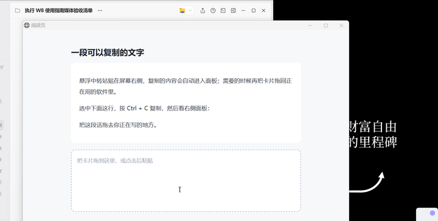

<em>复制的内容自动入库，拖出去即可交付</em>

  
  
  

  
  
  

> [!IMPORTANT]
> 支持 Windows 11 64 位（1.7.0 起 Windows 以 Windows 11 为开发与验证目标）。Mac 端曾提供至 1.20.0 测试包，已于 2026-10-08 永久停止开发并从仓库移除；历史 Release（含 1.6.0 Intel Mac 包与 1.20.0 Apple Silicon 测试包）原样保留在 [1.6.0](https://github.com/Oiawlm/floating-transfer-station/releases/tag/v1.6.0) 与 [1.20.0](https://github.com/Oiawlm/floating-transfer-station/releases/tag/v1.20.0) 历史发行版中，不撤回、不更新。

## 目录

- [✨ 功能特性](#-功能特性)
- [📦 下载与安装](#-下载与安装)
- [🚀 常用操作速查](#-常用操作速查)
- [📖 功能详解](#-功能详解)
- [🖼️ 界面一览](#️-界面一览)
- [📁 数据与卸载](#-数据与卸载)
- [⚠️ 当前限制](#️-当前限制)
- [💬 联系与反馈](#-联系与反馈)
- [🗺️ 路线图](#️-路线图)
- [📄 许可证](#-许可证)

## ✨ 功能特性

- **[随手收集](docs/usage.md#随手收集)**：复制图片或文字自动进入当前默认分类，5 秒内不重复收集相同内容。
- **[搜索过滤](docs/usage.md#搜索过滤)**：`Ctrl + F` 搜索当前分类，关键词与类型 chip 双重收窄，过滤不改任何数据。
- **[指定位置放入](docs/usage.md#指定位置放入)**：从资源管理器、浏览器、微信等软件把图片或文字直接拖到某个分类。
- **[批量复制](docs/usage.md#批量复制)**：一次复制多张图片按来源顺序入库，损坏文件不影响同批其他可用图片。
- **[图片容错](docs/usage.md#图片容错)**：多图片表示时自动保存像素最多的可用一份，照片保留正确的旋转方向。
- **[整理内容](docs/usage.md#面板与标签)**：置顶、多选、批量移动/删除、分类内排序；文字卡可就地编辑、添加备注（短卡备注入口可在设置「卡片备注」开启）。
- **[快捷启动](docs/usage.md#快捷启动)**：应用、已安装应用、网页地址或系统位置（回收站／此电脑）一键成瓦片，单击即启动（上限 200 个）；应用瓦片显示真实提取图标，网页瓦片自动抓取目标站点的 favicon（仅直连目标网站）；新装应用进入「发现 N」待确认清单，确认后才上屏。
- **[每日复盘](docs/usage.md#复盘标签)**：按天保存本地 Markdown（`reviews/yyyy-MM-dd.md`），双层箭头直接跳有记录的日子，实验性阅读视图可切换渲染呈现，可与 Obsidian 等编辑器同步。
- **[AI 整理](docs/usage.md#ai-整理)**：功能默认关闭，在设置 → AI 填入 DeepSeek API Key 并开启后，截断的长文字卡可一键整理成干净文字，整理提示词可自定义，`Ctrl + Z` 恢复原文；不需要时一键关闭整个功能（按钮消失、入口零请求，已存 Key 与提示词保留）。
- **[自动清理](docs/usage.md#自动清理)**：非置顶卡片满保留时长自动删除（2～24 小时七档，默认 24），可整批撤销。
- **[复制与拖出](docs/usage.md#复制出去)**：左键单击卡片右半复制这一张，左键单击文字卡左半把全文直接送进当前输入框（自动粘贴后恢复剪贴板），或 `Ctrl + C` 复制选中；Windows 通用拖放格式可拖到其他软件。
- **[不挡工作区](docs/usage.md#不挡工作区)**：贴屏幕右侧保持最上层，空闲收成一条标签；支持保持展开与一次性贴边隐藏。
- **[检查更新](docs/usage.md#更新)**：启动 30 秒首检、每 24 小时、连续 2 小时无操作三触发共用同一调度；任何检查发现新版本即自动「下载 → 校验 → 静默安装 → 重启」，无需手动确认。
- **[设置](docs/usage.md#设置)**：主题、界面字体、动效、标签顺序、快捷键、开机自启、启动·自动发现、启动·列数、数据目录、插件、AI 整理开关、DeepSeek Key 与整理提示词。
- **本地保存**：内容、顺序、置顶状态、分类名称和窗口位置全部保存在本机。

## 📦 下载与安装

在 [1.66.2 发行版](https://github.com/Oiawlm/floating-transfer-station/releases/tag/v1.66.2) 下载 Windows 安装程序：

| 平台 | 下载 | 状态 |
|---|---|---|
| Windows 11 x64 | [Windows 安装程序](https://github.com/Oiawlm/floating-transfer-station/releases/download/v1.66.2/FloatingTransferStation-Setup-1.66.2.exe) | 正式版 |

发行页同时提供 `SHA256SUMS.txt`。Windows 无需另装 .NET。

### Windows 安装

1. 运行安装程序。
2. 选择程序安装位置和内容存储父目录；不修改时使用当前用户的本地目录。
3. 安装完成后软件会启动，并在以后登录 Windows 时自动运行。

本地 Windows 构建产物使用中文名，GitHub Release 为了稳定下载链接使用上面的英文文件名。Release 页面中的 `Source code (zip)` / `Source code (tar.gz)` 是 GitHub 自动生成的源码包。

> [!NOTE]
> 安装包未经代码签名，首次运行时 Windows SmartScreen 可能提示「Windows 已保护你的电脑」。这时逐步操作即可继续安装：
>
> 1. 在提示框中单击「更多信息」。
> 2. 单击「仍要运行」，安装程序随即启动。
>
> 运行安装程序更新版本后，开机自启会重新开启，可在设置中再次关闭。

## 🚀 常用操作速查

卡片左右两半各有手势语义，右键全卡面统一为选择——先认这张分区图，再看分表：

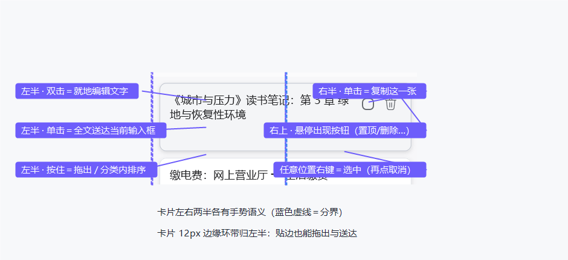

*卡片手势分区图：左半与右半的分界、右上按钮与边缘环带的归属（删除钮左右键语义见[删除钮图解](docs/images/card-delete-buttons.png)）*

**面板与标签**

| 操作 | 效果 | 演示 |
|---|---|---|
| 复制图片或文字 | 自动入库当前默认接收分类 | [批量复制](docs/images/batch-copy-images.gif) |
| 拖内容到分类标签 | 放入指定分类 | [拖入分类](docs/images/drag-into-category.gif) |
| 单击右侧分类标签 | 切换本次运行的默认接收分类 | — |
| 双击分类标签或 `F2` | 原地改名（最多 6 个可见文字单元） | — |
| 鼠标移开 / 移入 | 面板自动收成标签 / 重新展开 | [收起与保持展开](docs/images/edge-collapse-hold.gif) |

**卡片（左半 = 内容区，右半 = 操作区）**

| 操作 | 效果 | 演示 |
|---|---|---|
| 双击卡片左半 | 文字卡就地编辑（图片卡不可编辑） | — |
| 编辑中点击编辑器外部 | 提交并退出（四处编辑位共用；复盘为立即保存） | — |
| 单击卡片右半 | 复制这一张到剪贴板（修饰键不影响） | — |
| 单击卡片左半（文字卡） | 全文送达当前输入框（双击时限后触发；双击仍是编辑、拖出仍是拖拽） | [送达输入框](docs/images/card-deliver-input.gif) |
| 右键卡片任意位置 | 选中；再点一次取消（裸右键与 `Ctrl + 右键` 等效） | [多选与置顶](docs/images/multi-select-batch-pin.gif) |
| `Shift + 右键` | 连续区间选择（`Ctrl + Shift + 右键` 追加区间） | — |
| 卡片右上角垃圾桶 | 左键删除这一张（可撤销）；右键永久删除（不可撤销、无确认框） | [右键永久删除](docs/images/card-delete-permanent.gif) |
| 悬停卡片右上角 | 置顶、多选、删除、添加备注或 AI 整理（短卡备注可设置开启） | — |
| 悬停文字卡右上角「插件动作」钮 | 打开「插件动作」菜单（装有启用的 text-actions 插件时） | — |
| 按住卡片拖动 | 分类内排序（落点＝原位置时不显示指示线）、移到其他分类或拖到外部软件 | [拖拽重排](docs/images/drag-reorder.gif) |
| 点击卡片列表空白 | 清空当前选择（拖动滚动条除外） | — |
| ⚠️ 顶部垃圾桶 | 有选择删选中；无选择左键清空非置顶、右键清空全部（可撤销） | — |

**复盘（记录标签）**

| 操作 | 效果 | 演示 |
|---|---|---|
| 直接输入 | 停顿后自动保存到当天 `reviews/yyyy-MM-dd.md` | [按天记录](docs/images/review-tab.gif) |
| `‹` / `›` | 前一天 / 后一天 | 同上 |
| `«` / `»` | 直接跳到上一个 / 下一个有记录的日子（空白日自动跳过） | [双层箭头跳转](docs/images/review-date-jump.gif) |
| 「阅读 / 编辑」切换 | 实验性 Markdown 阅读视图（设置 → 通用开启） | [阅读视图](docs/images/review-markdown-toggle.gif) |

**快捷启动**

| 操作 | 效果 | 演示 |
|---|---|---|
| 单击瓦片 | 启动对应应用，面板自动收起 | — |
| 双击名称带 | 就地改名 | — |
| 右键瓦片 | 打开 / 重命名 / 编辑目标 / 上移下移 / 删除 | — |
| 拖动瓦片 | 调整顺序（跟手无迟滞） | — |
| 拖 `.exe` / `.lnk` 进面板 | 变成启动瓦片 | — |

键盘底线（完整快捷键表见[操作手册](docs/usage.md#操作手册)）：

- `Ctrl + A` 全选当前分类内容，`Esc` 取消全部选择（退出搜索优先）。
- `F2` 改名当前展开分类（`Enter` 保存、`Esc` 取消）。
- `Delete` 或 `Backspace` 只删除选中项（正在编辑文字时正常删字）。
- `Ctrl + P` 批量置顶或取消置顶（仅面板展开且不在编辑分类名称时生效）。
- `Ctrl + Z` 撤销最近一批删除或 AI 整理。
- `Ctrl + C` 复制选中项（面板持有键盘焦点且有选择时）。

## 📖 功能详解

每项功能的完整行为、边界、失败处理与全部快捷键，见[功能详解与操作手册](docs/usage.md)：

[面板与标签](docs/usage.md#面板与标签) ｜ [收集与入库](docs/usage.md#收集与入库) ｜ [查看与整理](docs/usage.md#查看与整理) ｜ [快捷启动](docs/usage.md#快捷启动) ｜ [不挡工作区](docs/usage.md#不挡工作区) ｜ [设置](docs/usage.md#设置) ｜ [更新](docs/usage.md#更新) ｜ [操作手册](docs/usage.md#操作手册) ｜ [历史版本兼容](docs/usage.md#历史版本兼容)

## 🖼️ 界面一览

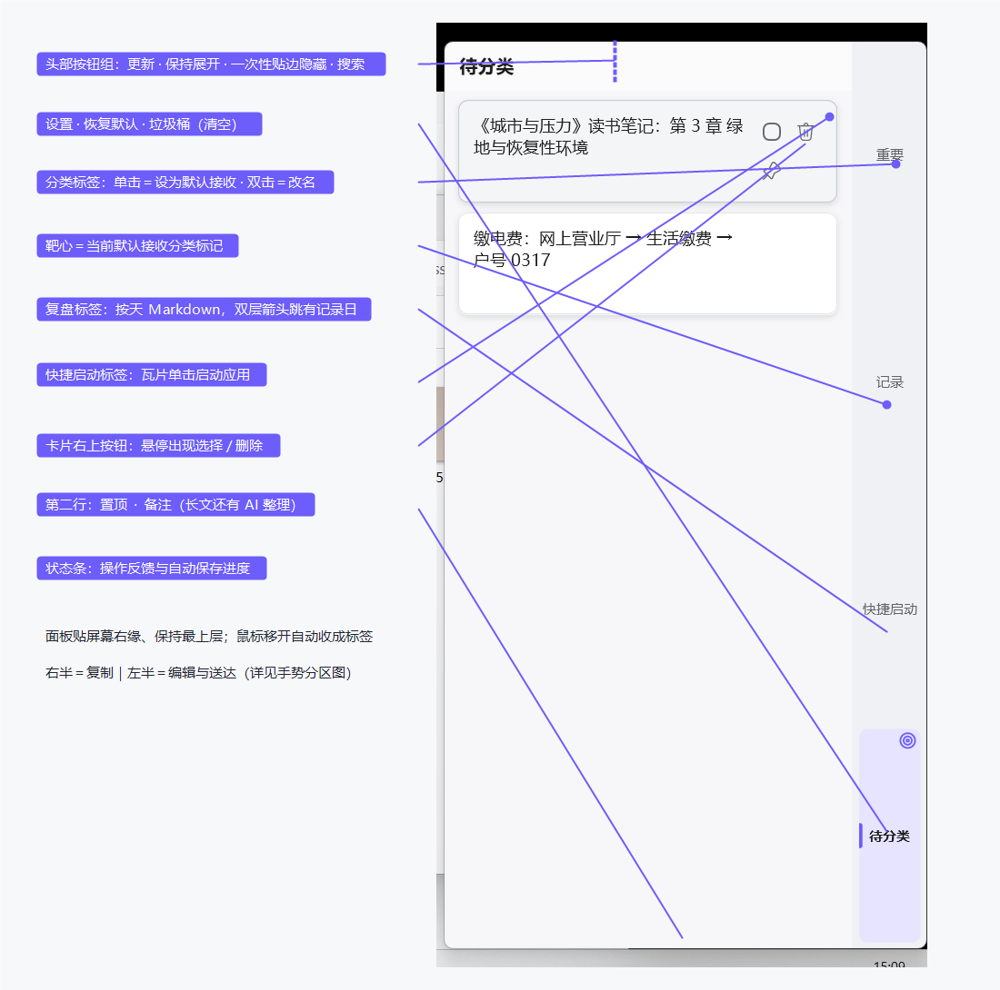

*展开态面板的结构：头部按钮组、四个标签、默认接收标记、卡片与状态条*

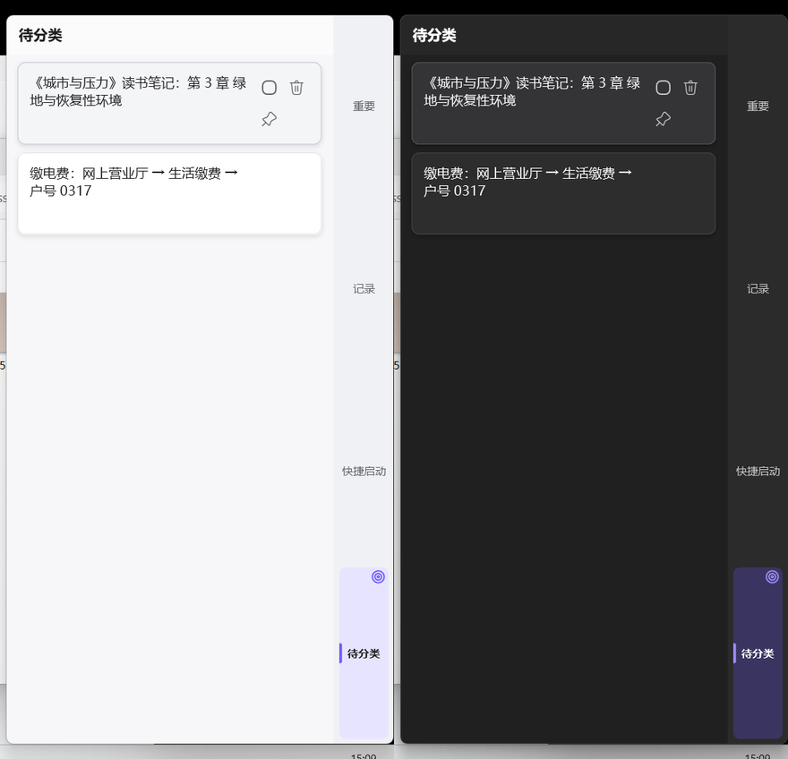

*浅色与深色主题同一面板*

*移开收成标签，移入展开，保持展开不再收起*

<strong>界面图集（点击展开）</strong>

**收集与拖放**

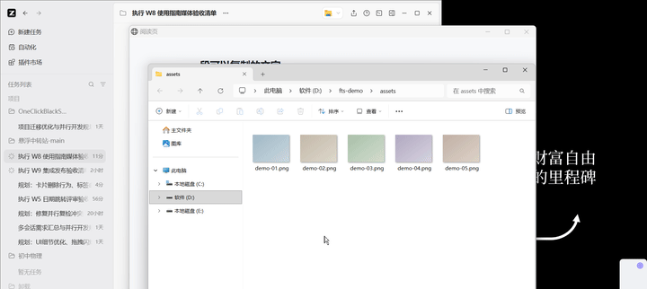

*一次复制多张图，按来源顺序入库*

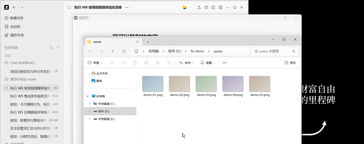

*拖到指定分类标签，内容进入该分类*

**卡片手势**

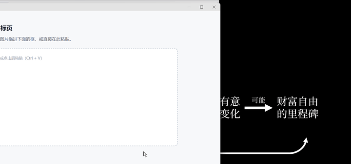

*左半单击＝送达：全文直接进当前输入框（自动粘贴后恢复原剪贴板）*

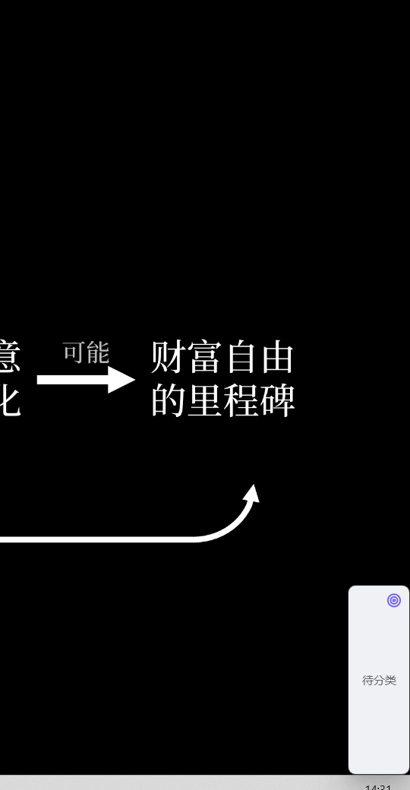

*删除钮双语义：左键可撤销删除，右键永久删除*

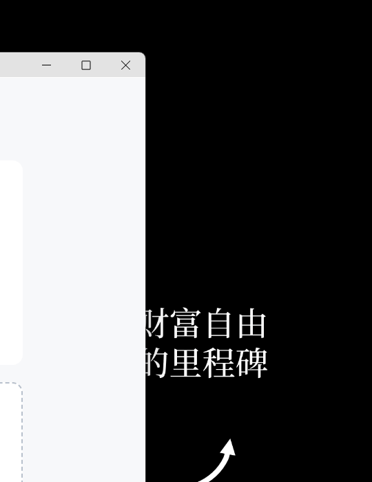

*分类内拖动重排：换位时显示插入指示线，落点＝原位置时不显示*

**整理与置顶**

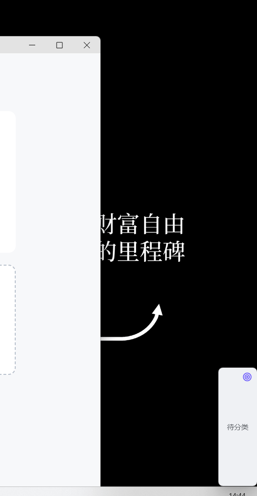

*右键多选、批量置顶、整批拖到另一分类*

*默认实线：置顶区与普通区之间的分隔标识；虚线见 [pinned-divider-dashed.png](docs/images/pinned-divider-dashed.png)，强调条见 [pinned-divider-accent-bar.png](docs/images/pinned-divider-accent-bar.png)，关闭（纯间距）见 [pinned-divider-none.png](docs/images/pinned-divider-none.png)*

**复盘与更新**

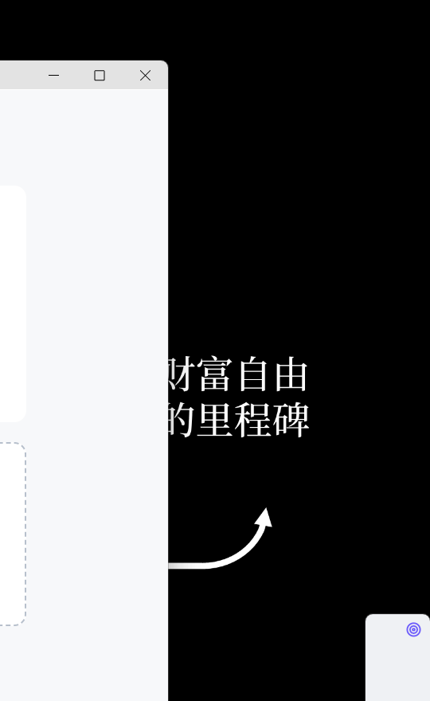

*复盘按天保存，切换日期内容仍在*

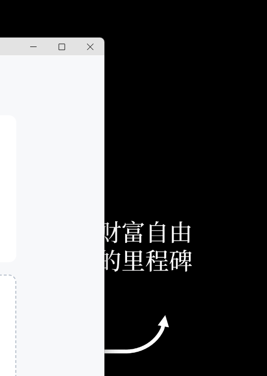

*双层箭头 `«` `»`：直接跳到上一个 / 下一个有记录的日子*

*实验性 Markdown 阅读视图：同一份 `.md`，阅读态渲染、编辑态改原文*

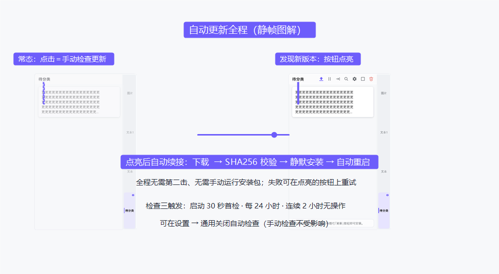

*自动更新流程图解：发现新版本即自动「下载 → 校验 → 静默安装 → 重启」*

**快捷启动**

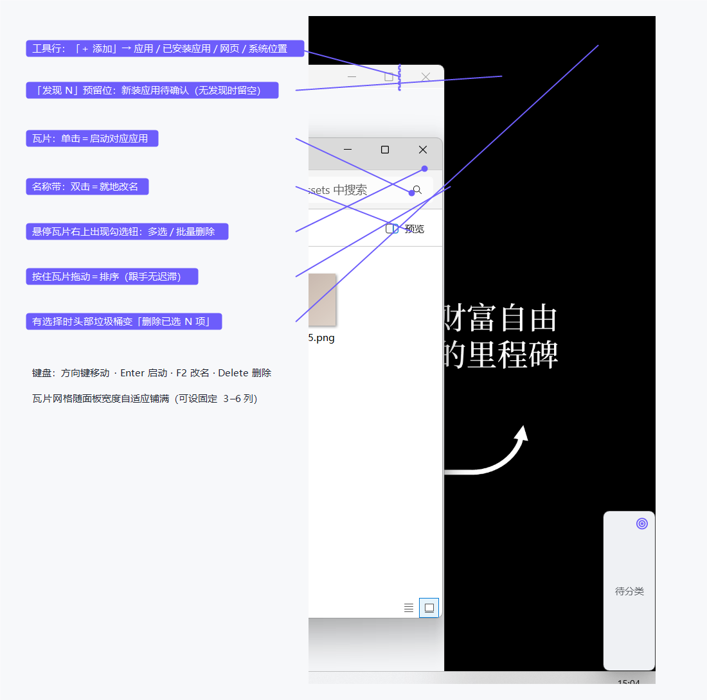

*启动页布局图解：工具行、瓦片、名称带与多选/排序手势*

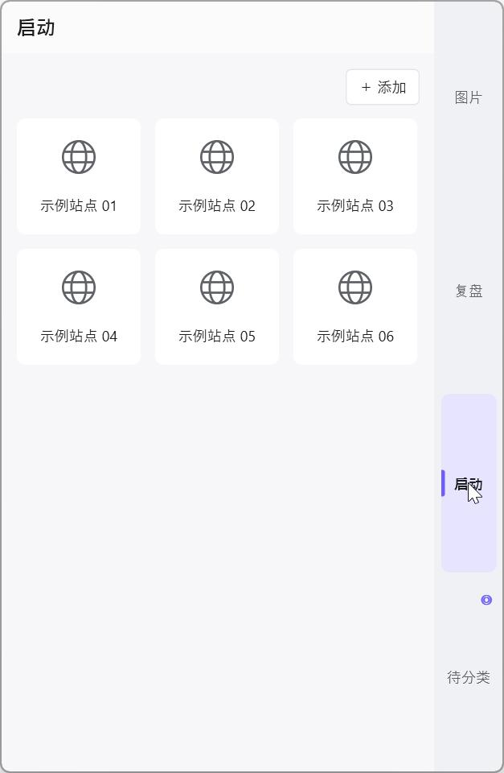

*启动标签：瓦片网格随面板宽度拉伸铺满（无死区），单击瓦片即启动应用；深色主题见 [quicklaunch-surface-dark.png](docs/images/quicklaunch-surface-dark.png)*

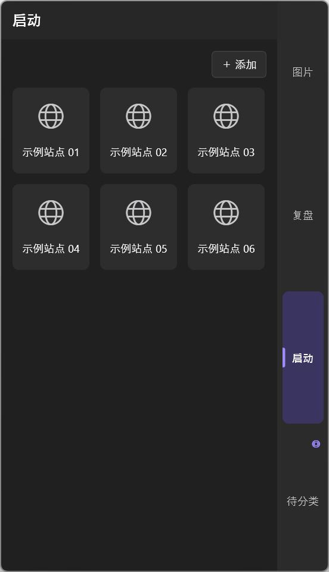

*多选与批量删除：瓦片悬停/选中时右上角出现勾选钮（Ctrl/Shift/Ctrl+A 支持），选中后头部垃圾桶变为「删除已选 N 项」，删除可整批撤销；名称带双击就地改名，拖动排序全时可用*

*右键任意瓦片：打开／重命名／编辑目标…（创建后可改目标，Alt+Enter 同入口）／上移／下移（端点自动置灰）／删除（独立分组，可撤销）*

*「＋ 添加」→「网页地址…」对话框：与主面板一致的主题化不透明表面与系统圆角阴影；「已安装应用…」支持搜索过滤与多选一次添加（含商店等打包应用）；深色主题见 [quicklaunch-url-dialog-dark.png](docs/images/quicklaunch-url-dialog-dark.png)*

**启动·自动发现**

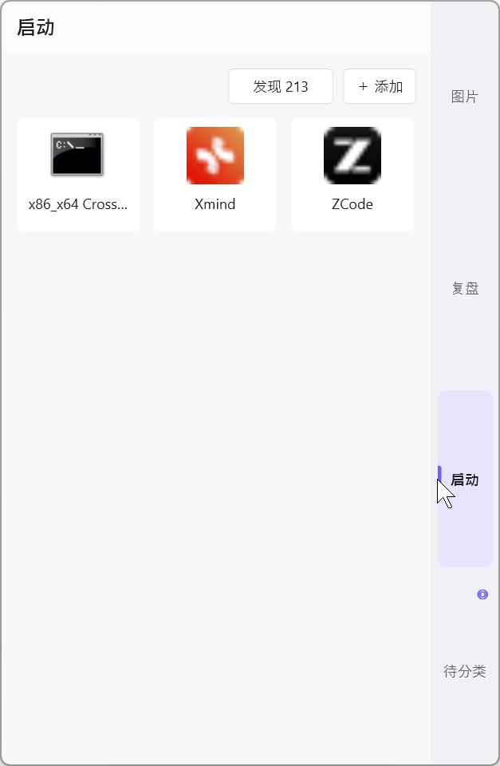

*新装应用自动进入「发现 N」待确认清单（确认制，绝不自动上屏）：工具行为发现入口固定预留位置，无发现时留空、「＋ 添加」位置恒定；浅色主题见 [launcher-discovery-button-light.png](docs/images/launcher-discovery-button-light.png)*

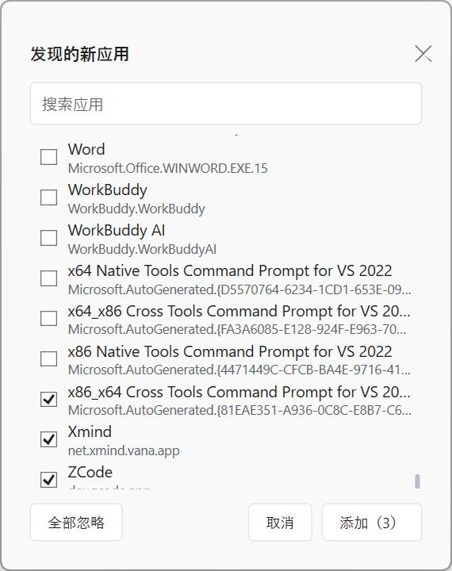

*「发现 N」打开待确认清单：多选「添加」走与手动添加完全相同的导入管线，「全部忽略」被持久记住；深色主题见 [launcher-discovery-picker-dark.png](docs/images/launcher-discovery-picker-dark.png)*

*设置 → 面板 →「启动·自动发现」：开关＋监视文件夹管理（改动即时生效并自动保存）；深色主题见 [launcher-discovery-settings-dark.png](docs/images/launcher-discovery-settings-dark.png)*

**设置**

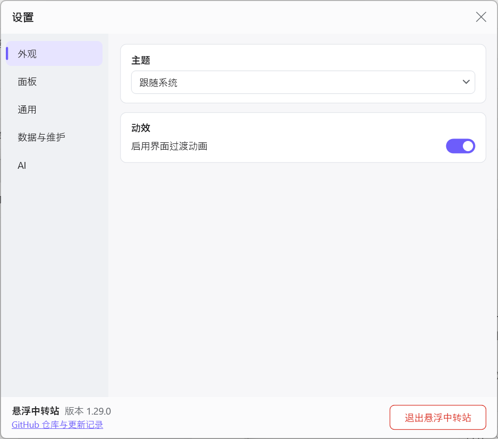

*设置窗口双栏布局：左侧导航 5 组，右侧内容页按卡片分组；深色主题见 [settings-window-dark.png](docs/images/settings-window-dark.png)，调整尺寸后经持久化恢复见 [settings-window-resized.png](docs/images/settings-window-resized.png)*

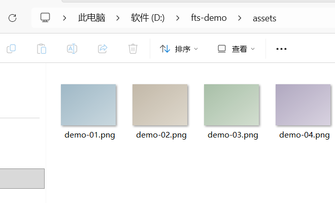

*「标签顺序」节深色主题：拖动行或用上移/下移按钮调整四个标签的显示顺序，行画刷随主题实时跟随*

**插件**

声明式插件，默认关闭：放入带 `plugin.json` 的文件夹即可出现在设置里——**文本整理**入库前自动整理文字，**文本动作**对选中卡片批量应用规则（可撤销）。设置区可逐插件启用与试运行；完整行为见[操作手册 · 插件](docs/usage.md#插件)，作者指南见 [docs/plugins.md](docs/plugins.md)。

*声明式插件默认关闭，放入即出现在设置里；深色主题见 [settings-plugins-dark.png](docs/images/settings-plugins-dark.png)*

**AI 设置与 AI 整理**

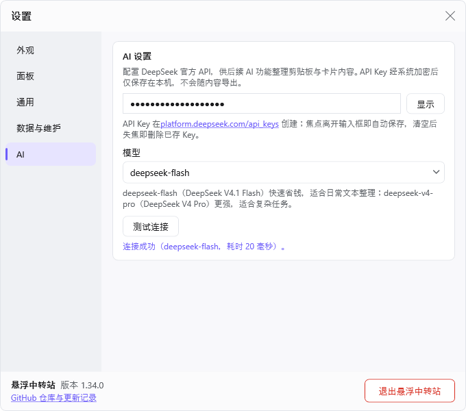

*AI 设置节：Key 掩码保存（图中为假 Key），「测试连接」就地反馈结果；深色主题见 [settings-ai-dark.png](docs/images/settings-ai-dark.png)，失败提示见 [settings-ai-test-failure.png](docs/images/settings-ai-test-failure.png)*

*AI 整理入口：截断文字卡悬停时右上按钮组追加行的「AI 整理」按钮；深色主题见 [card-ai-organize-dark.png](docs/images/card-ai-organize-dark.png)，整理前后对比见 [card-ai-organize-before.png](docs/images/card-ai-organize-before.png) 与 [card-ai-organize-after.png](docs/images/card-ai-organize-after.png)*

## 📁 数据与卸载

> [!WARNING]
> 卸载会删除程序、自启项，以及应用登记并管理的数据目录（即所选文件夹下的 `悬浮中转站` 文件夹本身，历史位置为 `Data` 与 `悬浮中转站\Data`）；不会删除你选择的文件夹里的其他文件。重要内容仍建议另外备份。

- 默认程序目录是 `%LocalAppData%\Programs\悬浮中转站\`，默认数据目录是 `%LocalAppData%\悬浮中转站\`（数据与插件都直接放在这个文件夹里）。安装或更新时可以改选两者的位置；旧版本的 `Data` 布局会在升级后首次启动时自动迁移到新布局。
- 从 1.4.3 或更早版本升级的步骤与卸载器边界说明，见[历史版本兼容](docs/usage.md#历史版本兼容)。

## ⚠️ 当前限制

以下限制适用于 Windows 正式版。

- 动态分类增删与常驻模式仍在路线图中；剪贴板采集开关等待收集更多使用场景。
- 每个编码图片表示或源文件最多 64 MiB、6,400 万像素，超限不会静默缩小原图；连续大量复制达到待处理容量上限时，会提示稍后重新复制。
- 外部拖放基于 Windows 通用格式；不同软件实际提供的格式不同，因此不是所有来源都能接收。
- 图片分类反馈稍晚、微信复制图片偶发生成两份，属于低优先级现场观察，自动测试环境未能稳定复现。

遇到问题可以提交 [Bug 报告](https://github.com/Oiawlm/floating-transfer-station/issues/new?template=bug_report.yml)，有新想法可以提交 [功能建议](https://github.com/Oiawlm/floating-transfer-station/issues/new?template=feature_request.yml)。

## 💬 联系与反馈

也可以直接联系开发者：微信号 `niubizhe_gengzhudong`（扫码或加好友时请注明来意），或在 [GitHub Issues](https://github.com/Oiawlm/floating-transfer-station/issues) 留言。设置窗口页脚的「关于」区同样可以扫码与一键复制微信号。

## 🗺️ 路线图

分类管理（动态增删）、外部拖入激活方式与常驻模式等仍需逐项设计，完整说明见[路线图](ROADMAP.md)。

## 📄 许可证

本项目使用 [MIT License](LICENSE)。
